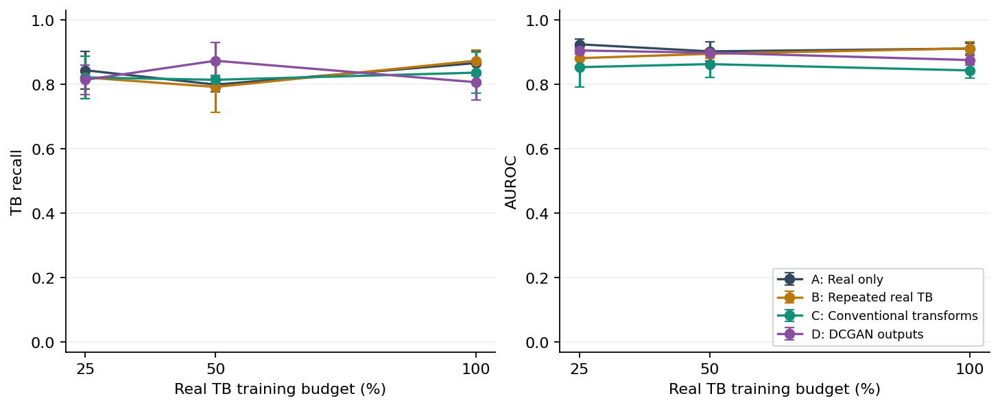
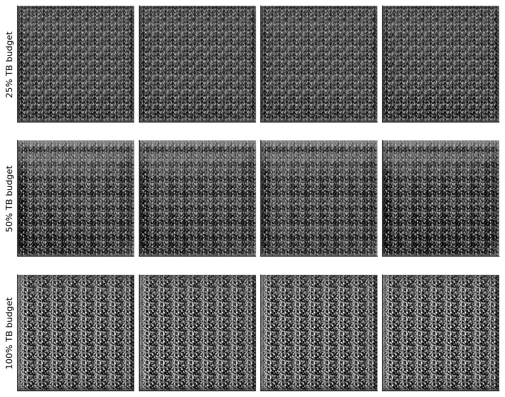

# AURORA

**Controlled evaluation of a DCGAN augmentation pipeline for TB chest radiograph classification**

[](LICENSE)

The planned experiment completed: **36 classifiers, nine 200-epoch GANs, three TB training budgets and three seeds**. Saved GAN grids showed repetitive noise-like patterns rather than convincing chest anatomy. This project reports that failure; it does **not** demonstrate successful medical-image synthesis or clinical readiness.

## Read the research

- [Current manuscript (PDF)](paper/publication_v2/manuscript.pdf)
- [Editable manuscript source](paper/publication_v2/manuscript.md)
- [Measured outcomes and uncertainty](paper/publication_v2/paper_results.json)
- [Execution and verification record](docs/PUBLICATION_RESULTS.md)
- [Project status](PROJECT_COMPLETION_TRACKER.md)

Rayan Rahman · Marathwada Mitra Mandal Institute of Technology. The manuscript is for faculty review; no publication acceptance or institutional approval is claimed. The earlier feasibility-only draft is preserved in `paper/professor_review/`.

## Findings



A: real only; B: repeated real TB images; C: mild TB-only conventional transforms; D: DCGAN outputs assigned the positive label. B and D add identical counts. Error bars show sample standard deviation across three seeds.

D had lower mean recall than A at 25% and 100% TB budgets. At 50%, D increased mean recall from 0.800 to 0.874 while specificity decreased from 0.829 to 0.713. This is a trade-off under one fixed split, not a consistent augmentation benefit. The outputs were not convincing radiographs, so classification differences cannot be attributed to preserved TB findings.



These are generated research outputs, not patient images or validated TB examples. Negative and inconclusive findings are retained.

## Design and reproducibility

The study retained 590 of 800 NLM images by excluding all 210 images involved in a frozen 206-pair similarity audit. No original image was deleted or relabelled. The split is 413/89/88; TB training budgets are 52/105/210 with all 203 normal training images retained. Patient identifiers are unavailable, so image disjointness is not patient independence.

Each pretrained ResNet-18 received 1000 updates. Validation selected checkpoints and thresholds; testing occurred after all 36 fits. GANs received only selected real TB training tensors. Original hashes are unchanged. The grid used commit `c915a7b` and the [v2.1 numerical correction](docs/PUBLICATION_V2_1.md) to the [execution design](docs/PUBLICATION_V2.md). The initial AMP-overflow failure is preserved and disclosed.

The initial candidate-screening implementation and thresholds have not been fully recovered. Source-level manifests, images and weights remain local, so public aggregates alone cannot recreate the selected population. Dataset/model redistribution rights are separate from the software license.

## Run locally

Use Python 3.10–3.12 and the pinned dependencies:

```powershell
python -m venv .venv
.venv/Scripts/Activate.ps1
python -m pip install -r requirements.txt
python -m pip install -e . --no-deps
python -m pytest -q
python -m streamlit run app/streamlit_app.py
```

MediSyn displays the measured aggregate report. Generation requires a locally configured checkpoint via `AURORA_CHECKPOINT`; no trained weights or medical-image upload feature are provided. Public hosting has not been deployed.

## Experiment commands

These require the original local data/audit inputs and explicit hash-bound approval for the exact implementation. Historical v1 and two-epoch feasibility approvals cannot authorize this runner.

```powershell
python -m src.study.publication --config configs/study_publication_v2_1.yaml --approval outputs/publication_v2_1_approved_20261119.json --output outputs/publication_v2/new_run --check-only
python -m src.study.publication --config configs/study_publication_v2_1.yaml --approval outputs/publication_v2_1_approved_20261119.json --output outputs/publication_v2/new_run
python -m src.study.fast_analysis --run outputs/publication_v2/new_run --output outputs/publication_v2/new_analysis
```

Do not reuse the exposed test set for repeated model selection. A repaired generator needs a separately documented evaluation. Computational completion is not scientific acceptance, privacy protection or diagnostic validity.

## Code and license

`src/study/` contains gates, experiments and analysis; `src/gan/` and `src/classifier/` contain models; `app/` contains the demo; `tests/` contains software checks. See the [model card](docs/MODEL_CARD.md), [dataset card](docs/DATASET_NLM.md), [verification history](docs/TEST_REPORT.md) and [deployment notes](docs/DEPLOYMENT.md).

Code is licensed under [Apache 2.0](LICENSE). Cite the exact commit using [CITATION.cff](CITATION.cff). Raw images, credentials, private review decisions and model checkpoints are not released.
