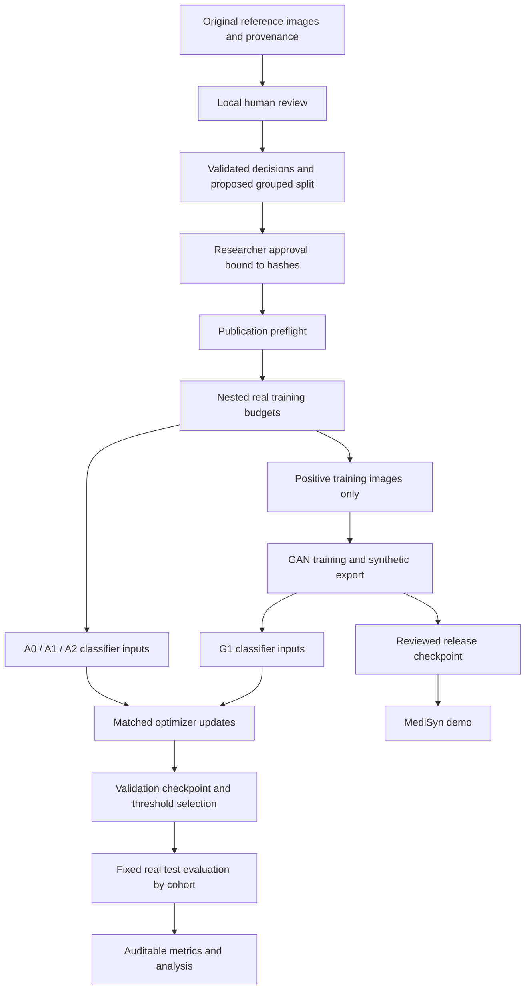

# MediSyn architecture

MediSyn is a local Python research toolkit with a Streamlit presentation layer. Training and human review stay local; the deployable demo does not accept patient-image uploads or launch training.

| Component | Implementation | Contract |
|---|---|---|
| Review interface | `tools/provenance_review/` | Loopback-only, attributed decisions, separate conflicts, local history |
| Canonical preparation | `src/study/data.py` | Reviewed pairs, connected groups, deterministic split, image hashes |
| Publication authorization | `src/study/gate.py` | Explicit human attestation, frozen config/protocol/manifest hashes |
| Controlled experiment | `src/study/runner.py` | Fixed update count, same real evaluation sets, nested budgets, provenance |
| Synthesis | `src/gan/` | DCGAN/WGAN-GP, grayscale 128px, metadata checkpoints, seeded inference |
| Classifier | `src/classifier/` | ResNet-18; historical exploratory trainer retained separately |
| Metrics and diagnostics | `src/evaluate/`, `src/study/analysis.py` | Probabilities, per-cohort metrics, grouped CIs, paired deltas, calibration, fidelity screens |
| Demonstration | `app/streamlit_app.py` | Explicit unavailable states, synthetic PNG export, reviewed results only |

The study runner uses a dedicated fixed-update training routine because the historical classifier trainer uses epochs and early stopping. These are different experimental contracts. Publication instructions point only to the gated runner. Historical scripts and old smoke artifacts remain for traceability.

The approval file is not a digital signature or clinical endorsement. Changes to its bound files invalidate the preflight. Researchers remain responsible for review authenticity and final scientific judgments. No automatic method converts a similarity score into human approval.
