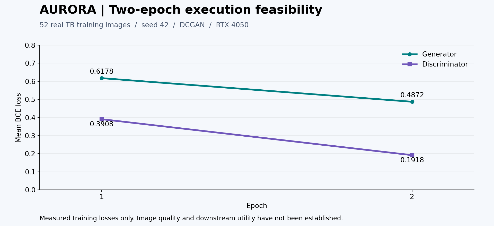

> Superseded for faculty review by [the current manuscript](../paper/professor_review/manuscript.pdf). This earlier draft is retained for traceability.

# AURORA: An Auditable Protocol and DCGAN Execution Feasibility Study for Synthetic Chest Radiograph Augmentation

**Rayan Rahman**

Marathwada Mitra Mandal Institute of Technology

**Working draft — 19 November 2026. Protocol and feasibility report; not a completed augmentation-effectiveness study.**

## Abstract

Synthetic image augmentation requires separating generator execution, image fidelity and downstream predictive utility. We present AURORA, an auditable research pipeline and prospective four-condition protocol for TB-manifestation-labelled chest radiographs. From an inventory of 800 Shenzhen and Montgomery images, automated exclusion of all 210 images involved in 206 flagged similarity pairs retained 590 images: 289 normal and 301 TB-labelled. A cohort- and label-stratified split allocated 413/89/88 images to training/validation/testing. A separate hash-bound approval gate restricted a two-epoch DCGAN feasibility run to 52 real TB training images at the 25% budget, seed 42. The run completed on an NVIDIA RTX 4050 Laptop GPU with 1.32 seconds recorded trainer runtime and 216.92 MiB peak PyTorch allocation. Both epochs had finite losses; the final checkpoint passed epoch/configuration checks. No validation or test image was read by the generator. These findings establish bounded execution feasibility only. Real-only, duplicated-real, conventional-augmentation and synthetic-augmentation comparisons remain unexecuted. Automated selection bias, missing patient identifiers and absent clinical validation constrain interpretation.

## 1. Introduction

Synthetic radiographs offer a testable approach to augmenting limited labelled training sets. Adding images, improving visual realism and improving performance on real evaluation images are different outcomes. An informative experiment must distinguish nominal oversampling from any benefit introduced by a learned generator.

The Shenzhen and Montgomery collections support research on pulmonary-disease manifestations [1]. Here, TB-labelled denotes the source image label rather than independently confirmed infection. Scarcity is imposed experimentally by limiting positive training images while keeping normal training images fixed; it does not represent population disease prevalence.

AURORA contributes documented dataset selection, provenance-bound execution and a prospective count-matched protocol. Its present measured contribution is a bounded feasibility run, not a new generator architecture or evidence of augmentation superiority. Positive, negative and null outcomes are equally reportable.

## 2. Related work

DCGAN provides a convolutional adversarial image-learning baseline [2]. Its architectural design does not itself establish preservation of radiographic disease features. Morís et al. investigated adapted latent diffusion for chest-radiograph pathological analysis [3]; their models and experimental conditions differ from this feasibility study.

Pink and Sykes compared synthetic augmentation with count-matched real duplication under fixed classifier optimization budgets [4]. In their experiments, superior generative metrics did not imply superiority over duplicated-real controls. This motivates AURORA's duplication comparator and separation of fidelity from utility. Such controls are prior work, not an original AURORA invention.

Folguera-Profitós et al. reviewed synthetic medical-image quality and downstream training impact, identifying heterogeneous evaluation and limitations in reproducibility and bias assessment [5]. Their synthesis motivates explicit evidence boundaries; it does not validate AURORA outputs. This is a targeted literature discussion, not a systematic review.

## 3. Materials and implemented methods

### 3.1 Dataset selection

The original local NLM inventory contains 800 images, comprising 406 normal and 394 TB-labelled images. A pre-existing audit contains 206 flagged candidate pairs involving 210 unique images. The primary selection excludes their complete union regardless of label or similarity score. This is automated similarity-based exclusion, not confirmed duplicate removal or human adjudication. No originals were deleted or relabelled.

**Table 1. Image-level selection and split counts.**

| Cohort and label | Original | Excluded | Retained | Train | Validation | Test |
|---|---:|---:|---:|---:|---:|---:|
| Shenzhen normal | 326 | 112 | 214 | 150 | 32 | 32 |
| Shenzhen TB-labelled | 336 | 87 | 249 | 174 | 38 | 37 |
| Montgomery normal | 80 | 5 | 75 | 53 | 11 | 11 |
| Montgomery TB-labelled | 58 | 6 | 52 | 36 | 8 | 8 |
| Total | 800 | 210 | 590 | 413 | 89 | 88 |

Exclusion affected 26.25% of the inventory: 30.06% of Shenzhen versus 7.97% of Montgomery, and 28.82% of normal versus 23.60% of TB-labelled images. These differences make selection bias a material limitation. Unique exact hashes among retained images do not establish absence of transformed duplicates or repeated patients. Reproduction is conditional on the frozen candidate audit; the initial similarity-screening algorithm, thresholds and operating characteristics must be documented fully before an effectiveness submission.

### 3.2 Split, preprocessing and budgets

Within each cohort/label stratum, filenames are sorted and shuffled using one Python random generator seeded 42, processing strata in sorted order. Counts use floor-rounded 70/15/15 targets; remaining images follow descending fractional remainders, breaking ties train/validation/test. The resulting training set contains 203 normal and 210 TB-labelled images; validation contains 43/46 and testing 43/45. No patient identifiers are available, so patient-level independence cannot be claimed.

Inputs are converted to grayscale and resized to 128 by 128. Generator tensors are normalized to [-1,1]. High-bit-depth inputs are rejected without an explicit conversion. Planned classifier preprocessing repeats grayscale into three channels with ImageNet normalization. Square resizing and low resolution may remove relevant detail.

One seeded ordering of TB training images defines nested prefixes of 52, 105 and 210 images at 25%, 50% and 100% budgets. All 203 normal training images remain fixed. Only the 52-image prefix, seed 42, was used in the completed feasibility run.

### 3.3 Approval and data access

A separate v2 approval gate binds seven artifacts: configuration, protocol, original reference, candidate audit, retained manifest, exclusion manifest and split JSON. It additionally checks exact ordered source IDs, selection and effective-configuration digests, implementation commit and implementation-file digest. The gate reconstructs exclusion and allocation rather than trusting counts alone. The historical v1 human-review gate is unchanged.

The image reader rejects nonselected IDs before image reads, verifies hashes and decodes the same verified byte buffers. The trainer receives only 52 preloaded tensors, without dataset paths or a holdout loader. This is an application-level access boundary around trusted code, not an operating-system sandbox or proof of patient independence.

### 3.4 Bounded DCGAN configuration

The feasibility run uses latent dimension 100, generator/discriminator widths 64, binary cross-entropy objectives, Adam learning rates 0.0002 and betas 0.5/0.999. Batch size is 16, with one discriminator step per generator step and full-precision training. Real discriminator targets are smoothed to 0.9; fake targets are zero and generator targets are one. Gradient norms are clipped at 1.0.

Two epochs each contain batches of 16/16/16/4, giving eight generator and eight discriminator updates. Reported epoch losses are unweighted arithmetic means of batch losses, including the smaller final batch. The final epoch is retained without validation-based generator selection. The entry point enforces two epochs rather than inheriting the proposed publication setting of 200 epochs.

## 4. Measured feasibility results

One run completed at implementation commit `032adc296fce9d5195cf7f930bf9a14edda4419e`. Recorded read IDs matched the 52 approved sources with zero validation/test overlap. The final checkpoint passed epoch/configuration verification. No classifier was fitted and no holdout evaluation occurred.

**Table 2. Single-run measurements, not publication-grid performance.**

| Measurement | Observed value |
|---|---:|
| Trainer runtime | 1.3219228 s |
| Entry-function total runtime | 6.1936866 s |
| Peak PyTorch allocated GPU memory | 227,457,024 bytes (216.92 MiB) |
| Peak PyTorch reserved GPU memory | 295,698,432 bytes (282 MiB) |
| Generator mean loss, epochs 1 / 2 | 0.61777413 / 0.48718533 |
| Discriminator mean loss, epochs 1 / 2 | 0.39082992 / 0.19181255 |

The device was an NVIDIA GeForce RTX 4050 Laptop GPU. Total timing excludes interpreter/import startup; trainer timing includes its checkpoint/sample output. Memory values describe the PyTorch allocator, not whole-device process memory. One run provides no timing uncertainty estimate and cannot establish publication-grid runtime.

Prior focused verification recorded 39 passing software tests in 13.86 seconds, covering missing approval, changed hashes, incorrect sources and holdout rejection, plus historical-gate regressions. Trainer and GPU counters were stubbed in those tests; the real run above supplies separate execution evidence. Nine protected metadata/history hashes remained unchanged. No FID, KID, clinical quality assessment, memorization assessment or classifier metric was measured in this feasibility run.

## 5. Prospective comparison: not executed

The proposed study compares A (real only), B (A plus repeated real TB images), C (A with conventional augmentation only on TB training images) and D (A plus DCGAN synthetic TB images). B and D each add one image per selected TB training image: 52/105/210 additions. Their total training-set sizes are 307/413/623; A/C totals are 255/308/413. Count matching does not imply semantic equivalence or independent samples.

Condition C disables horizontal flips; candidate transforms include rotation up to 5 degrees, translation up to 5%, and brightness/contrast jitter 0.1. These choices are not clinically validated. D would train solely on the corresponding positive training budget for a fixed 200 epochs. WGAN-GP and diffusion are outside the primary comparison.

The proposed classifier is ImageNet-pretrained ResNet-18, Adam, learning rate 0.0001, weight decay 0.0001, batch size 16 and unweighted cross-entropy. Every condition would receive 1,000 updates, with validation every 100 updates and no early stopping. Minimum validation loss would choose the checkpoint; maximum validation F1 with a highest-threshold tie-break would choose the threshold, frozen for real-test evaluation. This is not a clinical operating point.

Three budgets and seeds 42/123/999 imply 36 classifier fits and nine GAN fits. TB recall is primary; AUPRC, F1, specificity and AUROC are supporting outcomes. Planned reporting includes every seed, mean/sample standard deviation, paired D-minus-A and D-minus-B contrasts, failures and uncertainty. Image-based intervals must not be described as patient-level intervals. The separate v2 publication runner still requires integration and authorization; no outcome table is populated before those experiments run.

## 6. Discussion and limitations

The run establishes that the approved access and checkpoint workflow executes at the smallest budget on the available GPU. It does not answer whether generated images improve TB classification. The proposed controls would help distinguish nominal oversampling from generator-specific utility, but conclusions would remain conditional on the tested setting.

Automated exclusion can remove valid images while leaving unidentified duplicates. Differential exclusion rates may bias the selected distribution. Missing patient identifiers prevent assurance of patient-disjoint evaluation, and source labels have not been independently revalidated. Low resolution and acquisition differences further constrain interpretation.

Montgomery validation/test each contain 19 images, including eight TB-labelled images; a single TB error changes subgroup recall by 12.5 percentage points. Cohort results would therefore be descriptive and uncertain. Two epochs provide no evidence about later stability, collapse, privacy, anatomical plausibility or diagnostic fidelity. The present report supports software feasibility, not clinical deployment.

## 7. Conclusion

AURORA provides an auditable 590-image subset, a prospective count-matched augmentation protocol and a completed two-epoch DCGAN execution check on 52 real TB training images. The measured result establishes bounded execution feasibility. Augmentation utility and image quality remain open experimental questions.

## Declarations and reproducibility

Code: https://github.com/xt67/AURORA, Apache License 2.0. Third-party data/model rights remain separate. Configuration SHA-256: `6a2b34cb819c805ba3e7523ed7ef65ef74dfb6b2c5ac9532155217e7354a950e`. Checkpoint SHA-256: `6d24fb1c9750a2e9e5c61162d83f36001c86e2141e541caa29f39ec33041ee6d`. Exact source identities and private approval records remain local.

Rayan Rahman is the sole named author. Corresponding-author email, department, contributions, funding, competing interests and applicable data-use/ethics determinations require author confirmation. No supervisor, clinician, ethics approval or exemption is invented.

AI assistance: this draft was written with Codex assistance from project evidence. Paper Orchestra's repository workflow was inspected and its local input package prepared [6]. Its external-model generation is pending successful setup/execution and must not be claimed as completed. All text, references and eventual generated revisions require author review.

## References

1. Jaeger S, Candemir S, Antani S, Wáng YXJ, Lu PX, Thoma G. Two public chest X-ray datasets for computer-aided screening of pulmonary diseases. *Quantitative Imaging in Medicine and Surgery*. 2014;4(6):475–477. https://doi.org/10.3978/j.issn.2223-4292.2014.11.20
2. Radford A, Metz L, Chintala S. Unsupervised Representation Learning with Deep Convolutional Generative Adversarial Networks. 2015/2016. https://arxiv.org/abs/1511.06434
3. Morís DI, de Moura J, Novo J, Ortega M. Adapted generative latent diffusion models for accurate pathological analysis in chest X-ray images. *Medical & Biological Engineering & Computing*. 2024;62:2189–2212. https://doi.org/10.1007/s11517-024-03056-5
4. Pink C, Sykes E. Disentangling dataset size from synthetic diversity in tuberculosis chest X-ray classification. *PMLR*. 2026;318:954–961. https://proceedings.mlr.press/v318/pink26a.html
5. Folguera-Profitós J, et al. Quality Assessment and Model Training Impact of Synthetic Images in Medical Diagnostic Imaging: Systematic Review. *JMIR AI*. 2026;5:e81472. https://doi.org/10.2196/81472
6. Google Research. PaperOrchestra software repository, inspected revision `d9bae997e793a015ed38bb1605be9eb58c00284f`. https://github.com/google-research/paper-orchestra
