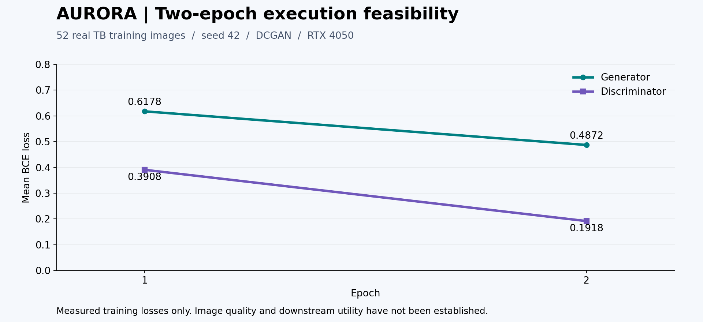

## Abstract

Synthetic radiographs may help address limited training data, but successful image generation alone does not demonstrate improved classification. This study describes the dataset preparation and initial execution test for AURORA, a chest radiograph augmentation project. An inventory of 800 Shenzhen and Montgomery images was screened using a frozen similarity audit. Excluding all 210 images involved in 206 flagged pairs left 590 images: 289 normal and 301 labelled with tuberculosis (TB) manifestations. A stratified image-level split allocated 413 images to training, 89 to validation and 88 to testing. A DCGAN was trained for two epochs using 52 TB-labelled training images, with seed 42. The run completed on an NVIDIA RTX 4050 Laptop GPU, recording 1.32 seconds of trainer runtime and 216.92 MiB peak PyTorch memory allocation. Both epochs produced finite losses, and the final checkpoint passed epoch and configuration checks. The generator read only the selected training images. This preliminary result confirms that the selected training and recording procedure can execute on the available hardware. It does not establish image quality, clinical validity or a classification benefit from synthetic augmentation.

## 1. Introduction

AURORA investigates whether synthetic chest radiographs can improve classification when few TB-labelled training images are available. The immediate task is to establish a reproducible dataset and a functioning training procedure before undertaking the comparison. The present report covers that preparatory stage and one short generator run.

The project uses the Shenzhen and Montgomery collections described by @jaeger2014. Throughout this report, “TB-labelled” refers to the source radiograph label, not to a diagnosis independently established for this study. Scarcity is introduced by restricting the positive training subset while keeping the normal training images fixed. This experimental imbalance should not be interpreted as an estimate of disease prevalence.

The contribution at this stage is a documented selection procedure, controlled access to training images and an execution record that can be checked against the code. The study does not introduce a new GAN architecture. Whether synthetic images add useful information beyond ordinary oversampling remains a question for subsequent experiments.

## 2. Related work

DCGAN provides a convolutional baseline for adversarial image learning [@radford2015]. AURORA uses this approach as a starting point, rather than as a method already shown to be best for the selected data. Work on adapted latent diffusion models has also investigated chest radiograph generation for pathological analysis [@moris2024]. Differences in model, dataset and training conditions prevent direct comparison with this two-epoch execution test.

A useful control is to repeat real images instead of generating new ones. Pink and Sykes found that better generative metrics did not produce better downstream performance than count-matched real duplication in their TB classification experiments [@pink2026]. Their result motivates AURORA's planned duplication control; it does not predict the outcome of this study. A systematic review likewise documents varied quality-assessment methods and limitations in reproducibility and bias assessment across synthetic medical-imaging studies [@folguera2026]. These findings support evaluating image quality and classification utility separately.

## 3. Materials and methods

### 3.1 Image selection

The local inventory contains 800 images: 406 normal and 394 TB-labelled. A pre-existing audit identified 206 potentially similar image pairs involving 210 distinct images. The selection rule excluded every image occurring in any flagged pair, irrespective of its label or score. All original files and labels were preserved.

This procedure is similarity-based exclusion, not confirmation that the excluded images are duplicates. It retained 590 images. Table 1 gives the cohort and label counts. Exclusion rates differed substantially: 30.06% for Shenzhen and 7.97% for Montgomery. Selection may therefore change the composition of the data and limit the generalizability of later findings.

Table: Table 1. Dataset selection and image-level allocation.

| Cohort and label | Original | Excluded | Retained | Train | Validation | Test |
|:---|---:|---:|---:|---:|---:|---:|
| Shenzhen normal | 326 | 112 | 214 | 150 | 32 | 32 |
| Shenzhen TB-labelled | 336 | 87 | 249 | 174 | 38 | 37 |
| Montgomery normal | 80 | 5 | 75 | 53 | 11 | 11 |
| Montgomery TB-labelled | 58 | 6 | 52 | 36 | 8 | 8 |
| **Total** | **800** | **210** | **590** | **413** | **89** | **88** |

The selection is reproducible from the frozen reference and pair index. The initial similarity-screening procedure and its thresholds still need fuller documentation before a definitive effectiveness study. Retained files have distinct exact hashes, but this does not rule out transformed duplicates or repeated patients.

### 3.2 Split and preprocessing

Within each cohort and label stratum, filenames were sorted and shuffled with one random generator seeded 42. Counts were allocated to a 70/15/15 target using floor rounding and the largest fractional remainders. Ties were resolved in training, validation, test order. The resulting split contains 413/89/88 images.

The training partition contains 203 normal and 210 TB-labelled images. Nested positive budgets contain 52, 105 and 210 images, obtained from one seeded ordering. The completed run used only the 52-image budget. Patient identifiers are unavailable in the project, so disjoint image partitions cannot be assumed to represent disjoint patients.

Generator inputs were converted to grayscale, resized to 128 × 128 pixels and normalized to [-1,1]. This resizing may discard small radiographic findings or distort aspect ratio. High-bit-depth inputs are rejected unless an explicit conversion is supplied.

### 3.3 Training access and reproducibility

Before training, the feasibility entry point checks an approval record against hashes of the configuration, protocol, original reference, pair audit, retained manifest, exclusion manifest and split. It reconstructs the selection and verifies the exact ordered source IDs, effective configuration and implementation version.

The image reader rejects unselected IDs before opening their image files. Selected files are checked against their recorded hashes, decoded from those same bytes and loaded into an in-memory tensor dataset. The trainer receives these tensors rather than a directory containing the full dataset. This is a software access control, not an operating-system sandbox or evidence of patient-level independence.

### 3.4 DCGAN execution test

The generator uses a latent dimension of 100 and generator/discriminator widths of 64. Both networks use Adam with learning rate 0.0002 and betas 0.5 and 0.999. Training uses binary cross-entropy, full precision, one discriminator update per generator update and gradient-norm clipping at 1.0. The discriminator's real targets are smoothed to 0.9, with fake targets of zero; the generator's target is one.

The run uses seed 42 and two epochs. With 52 images and batch size 16, each epoch contains batches of 16, 16, 16 and 4 images. The reported epoch loss is the arithmetic mean of the four batch losses, rather than an image-weighted mean. The final checkpoint is retained without quality-based selection. No classifier is fitted and no holdout evaluation is performed in this test.

## 4. Results

The two-epoch run completed on an NVIDIA GeForce RTX 4050 Laptop GPU. Its recorded read-ID list matched the 52 selected TB training images, with no validation/test overlap. The final checkpoint passed the required epoch and configuration checks. Table 2 reports the execution measurements.

Table: Table 2. Measurements from the single feasibility run.

| Measurement | Observed value |
|:---|---:|
| Trainer runtime | 1.3219 s |
| Total entry-function runtime | 6.1937 s |
| Peak PyTorch allocated GPU memory | 216.92 MiB |
| Peak PyTorch reserved GPU memory | 282.00 MiB |
| Generator mean loss, epochs 1 / 2 | 0.6178 / 0.4872 |
| Discriminator mean loss, epochs 1 / 2 | 0.3908 / 0.1918 |

Total timing excludes interpreter and import startup. Trainer timing includes its checkpoint and sample-output operations. Memory values describe PyTorch's allocator, not the total GPU footprint. Only one run was measured; no confidence interval or estimate of full-study runtime is inferred.

Both epoch losses were finite. There are no measured classifier scores, generative-quality scores or clinical-reader assessments from this run. The result supports execution feasibility under the stated configuration, rather than effectiveness of synthetic augmentation.

## 5. Discussion

The run provides a limited but useful development milestone: the selected training images can pass through the approval, preprocessing, optimization and checkpoint-recording procedure on the available GPU. That is sufficient to proceed with further evaluation, but not to conclude that the generated images are useful for TB classification.

Several limitations remain. Automated exclusion may remove valid images and leave unidentified near-duplicates. Its different rates across cohorts may introduce selection bias. Source labels were not independently clinically revalidated, and missing patient identifiers prevent assurance of patient-independent evaluation. The low image resolution and brief training duration also preclude conclusions about anatomical quality, memorization or longer-run stability.

The Montgomery validation and test partitions each contain 19 images, including eight TB-labelled images. One TB error would change subgroup recall by 12.5 percentage points. Later cohort-level results will need to report these small denominators and their uncertainty.

### Further work

The next stage will compare real-only training, repeated real TB images, mild conventional augmentation of TB images, and DCGAN-generated TB images. The repeated-real and synthetic conditions will add the same number of images at each positive-data budget. Conventional augmentation will exclude horizontal flipping. Classifier optimization budgets and real evaluation partitions will be held fixed. These comparisons have not yet been run; the detailed settings and remaining implementation work are documented in the repository. Their purpose is to measure whether synthesis adds value beyond simpler alternatives, including when the result is negative or inconclusive.

## 6. Conclusion

AURORA has completed dataset preparation and one reproducible DCGAN execution test using 52 TB-labelled training images. The run produced finite losses and a checkpoint consistent with the specified two-epoch configuration, without generator access to holdout images. These findings establish preliminary execution feasibility. The effect of synthetic augmentation on classification remains to be measured.

## Code and writing acknowledgment

Code, protocol and run documentation are available at [github.com/xt67/AURORA](https://github.com/xt67/AURORA) under Apache 2.0; dataset and model redistribution rights are separate. The execution used commit `032adc2`. Exact hashes and local artifact locations are recorded in the repository's feasibility report. No clinical or institutional approval is asserted by this technical report.

Codex and Paper Orchestra assisted with outlining, drafting and language editing. Numerical findings were drawn from the recorded experiment artifacts. This version is submitted for faculty review.
