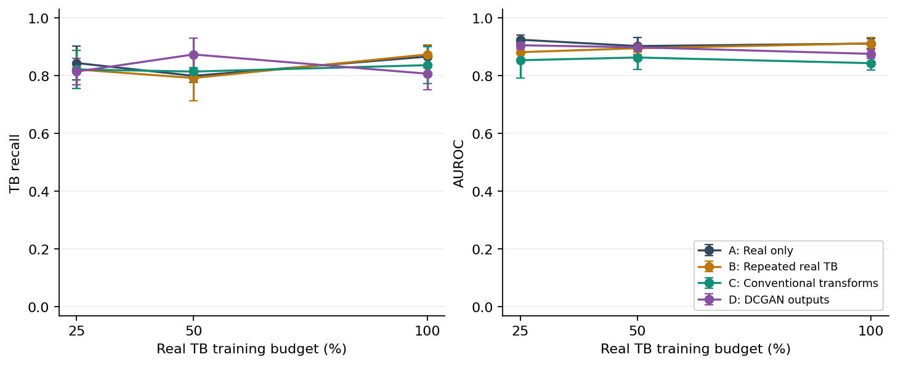
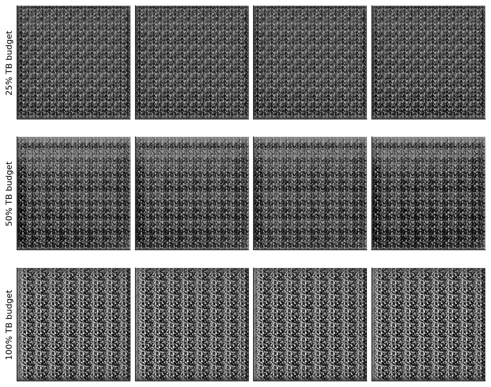

## Abstract

Synthetic images are often proposed as a response to limited medical training data, but generating outputs does not by itself establish image fidelity or a classification benefit. AURORA compares real-only training, repeated real tuberculosis (TB)-labelled images, conventional TB-only transformations and DCGAN outputs assigned the positive label. Automated exclusion of all 210 images in a frozen 206-pair similarity audit reduced an 800-image Shenzhen/Montgomery inventory to 590 images. A fixed image-level split contained 413 training, 89 validation and 88 test images. Nested training budgets contained 52, 105 or 210 real TB images, alongside 203 normal images. Each method used three seeds and an ImageNet-pretrained ResNet-18 trained for 1000 updates. Duplication and generation added identical counts. Nine DCGANs completed 200 epochs each; all 36 classifiers were fitted and selected on validation data before testing. Mean test recalls for generated-output augmentation and duplication were 25%: D 0.815, B 0.822; 50%: D 0.874, B 0.793; 100%: D 0.807, B 0.874. Saved grids from all nine GANs showed repetitive noise-like patterns rather than convincing chest anatomy. The results therefore characterize a failed-synthesis augmentation pipeline under fixed conditions, not successful disease-preserving radiograph generation or clinical utility.

## 1. Introduction

This study asks whether synthetic chest radiographs add useful training information when TB-labelled images are scarce, compared with repeating real images or applying mild conventional transformations. The distinction matters because adding more nominal training examples also changes the frequency with which the positive class is sampled. An apparent improvement over real-only training could therefore reflect oversampling rather than information supplied by the generator.

AURORA evaluates that question through a four-condition comparison with matched classifier update budgets. The source collections are Shenzhen and Montgomery, described by @jaeger2014. “TB-labelled” refers to the collection's radiographic label; it is not an independently established diagnosis for this study. Restricting the positive training subset creates experimental scarcity, not an estimate of population disease prevalence. The work uses established architectures and reports an experimental comparison rather than introducing a new generative model.

## 2. Related work

DCGAN provides a convolutional baseline for adversarial image learning [@radford2015]. AURORA uses this approach as a starting point, rather than as a method already shown to be best for the selected data. Work on adapted latent diffusion models has also investigated chest radiograph generation for pathological analysis [@moris2024]. Differences in model, dataset and training conditions prevent direct comparison with the present fixed-budget comparison.

A useful control is to repeat real images instead of generating new ones. Pink and Sykes found that better generative metrics did not produce better downstream performance than count-matched real duplication in their TB classification experiments [@pink2026]. Their result motivates AURORA's duplication control; it does not predict the outcome of this study. A systematic review likewise documents varied quality-assessment methods and limitations in reproducibility and bias assessment across synthetic medical-imaging studies [@folguera2026]. These findings support evaluating image quality and classification utility separately.

## 3. Materials and methods

### 3.1 Dataset selection and split

The original inventory contained 800 images: 406 normal and 394 TB-labelled. Every image involved in any of 206 frozen candidate pairs was excluded, leaving 590 images (289 normal and 301 TB-labelled). This rule removed 210 unique images without relabelling or deleting originals. Similarity-based exclusion does not confirm that an image is a duplicate. The original candidate-screening implementation and all its thresholds have not been fully recovered; the supplied pair index and subsequent exclusion rule are frozen and hash-bound. This limits end-to-end screening reproducibility.

Exclusion affected 30.06% of Shenzhen and 7.97% of Montgomery images, potentially changing cohort composition. The retained cohorts contained 214 normal/249 TB-labelled Shenzhen images and 75 normal/52 TB-labelled Montgomery images. Within sorted cohort/label strata, a seeded shuffle and largest-remainder allocation to 70/15/15 targets produced 413/89/88 training/validation/test images. The test set contained 43 normal and 45 TB-labelled images. Patient identifiers were unavailable; image disjointness does not establish patient disjointness.

All 203 normal training images were retained at every budget. One positive-image ordering, seeded 42, defined nested prefixes of 52, 105 and 210 TB training images. Validation and test images remained real, fixed and outside generator training. The seeds 42, 123 and 999 governed model initialization and run sampling; they did not generate new splits.

### 3.2 Four comparison conditions

Condition A used the selected real images only. Condition B added repeated real TB images, sampled uniformly with replacement. Condition C applied conventional transforms only when a sampled training image had the TB label; normal images received deterministic preprocessing. Condition D added DCGAN images assigned the nominal TB training label. B and D each added exactly one image per selected real TB source: 52, 105 or 210. A/C dataset counts were 255/308/413; B/D counts were 307/413/623. Synthetic samples were not filtered by appearance or diagnostic scores.

Images were converted to grayscale and resized to 128×128 pixels. Classifier inputs repeated grayscale across three channels and used ImageNet normalization; generator inputs used one channel in [-1,1]. High-bit-depth inputs were rejected without an explicit conversion. C applied affine rotation up to 5 degrees and translation up to 5%, followed by brightness/contrast jitter 0.1. Horizontal flips were disabled. These are experimental choices, not clinically validated transformations.

### 3.3 Generator training

One 128-pixel BCE DCGAN was trained for each budget/seed combination, giving nine fits. The latent dimension was 100; generator/discriminator widths were 64. Adam learning rates were 0.0002 with betas 0.5/0.999. Training used 200 epochs, batch size 16, no dropped remainder batch, one discriminator update per generator update and full precision. Real discriminator targets were smoothed to 0.9, with fake targets zero and generator targets one. Gradient norms were clipped at 1.0. During generator updates, discriminator parameters were frozen and its batch-normalization layers used evaluation mode; discriminator updates used training mode. Epoch losses were arithmetic means of batch losses. The final epoch was retained without quality-based checkpoint selection.

The image reader checked each selected source against its recorded hash and decoded those same bytes. The GAN received a tensor-only dataset containing the selected real TB images, with no image root, paths or evaluation loader. Generated images were exported as 8-bit PNGs using recorded sampling seeds. This is an application-level access control, not an operating-system sandbox or a patient-privacy guarantee.

### 3.4 Matched classifier training and evaluation

Each classifier used an ImageNet-pretrained ResNet-18 [@he2016] with a two-class output. Adam [@kingma2014] used learning rate 0.0001, weight decay 0.0001, batch size 16 and unweighted cross entropy. All conditions drew uniformly with replacement for exactly 1000 optimizer updates. Validation loss was measured every 100 updates. The checkpoint with minimum validation loss was retained, with the first checkpoint winning equal-loss ties. The decision threshold maximized validation F1, with the highest threshold breaking ties. That threshold was frozen for testing.

The initial publication attempt failed on the first training batch because the default AMP loss scale of 65536 produced a non-finite gradient. A training-only diagnostic reproduced the same loss at scale 1 with finite gradients. The documented v2.1 correction used initial scale 1 for every condition; it retained the default growth interval of 2000 and rejected non-finite gradients instead of silently skipping updates. The failed attempt and diagnostic remain archived. No test evaluation preceded this correction. All 36 corrected fits and checkpoint selections finished before test images were read.

### 3.5 Outcomes and diagnostic analysis

TB recall was the primary outcome. Supporting outcomes were AUPRC, F1, specificity, AUROC, confusion matrices, Brier score and ten-bin expected calibration error. We report seed means and sample standard deviations and paired D-minus-A/D-minus-B contrasts. Per-model intervals used 1000 percentile bootstrap replicates of image groups within cohort/label strata. Groups represent image identities, not patients. Three-seed bootstrap intervals for paired mean differences are descriptive and unstable; no hypothesis-test significance is claimed.

Generator diagnostics measured nearest-training-image and pairwise-synthetic RMSE after grayscale resizing to 64×64, plus exact duplicate image counts. The reference set was the selected TB training set for each generator. No validation/test reference was used. These pixel measures are exploratory memorization/diversity screens, not clinical fidelity or privacy tests. Optional FID/KID were not included in the frozen primary diagnostic plan.

## 4. Results

All 36 corrected classifier fits and nine 200-epoch GAN fits completed on an NVIDIA GeForce RTX 4050 Laptop GPU. The total recorded fit time was 2.37 hours; this includes dataset loading and, for D, generation and diagnostics, but excludes analysis and initial interpreter startup. Peak PyTorch allocated GPU memory across fits was 250.4 MiB. This allocator measurement does not represent the entire GPU footprint. The failed initial attempt is reported separately and is not pooled with the corrected grid.

Table: Table 1. Test outcomes, mean ± sample standard deviation across three seeds. The same 88 real test images were used in every condition.

| Condition | TB budget | Recall | AUPRC | F1 | Specificity | AUROC |
|---|---|---|---|---|---|---|
| A | 25% | 0.844 ± 0.059 | 0.936 ± 0.016 | 0.827 ± 0.016 | 0.791 ± 0.116 | 0.925 ± 0.015 |
| B | 25% | 0.822 ± 0.067 | 0.913 ± 0.018 | 0.801 ± 0.032 | 0.760 ± 0.059 | 0.882 ± 0.029 |
| C | 25% | 0.822 ± 0.067 | 0.872 ± 0.078 | 0.804 ± 0.008 | 0.767 ± 0.107 | 0.854 ± 0.062 |
| D | 25% | 0.815 ± 0.046 | 0.925 ± 0.011 | 0.812 ± 0.042 | 0.791 ± 0.182 | 0.906 ± 0.012 |
| A | 50% | 0.800 ± 0.022 | 0.924 ± 0.019 | 0.815 ± 0.025 | 0.829 ± 0.054 | 0.903 ± 0.029 |
| B | 50% | 0.793 ± 0.078 | 0.919 ± 0.008 | 0.789 ± 0.010 | 0.775 ± 0.117 | 0.896 ± 0.014 |
| C | 50% | 0.815 ± 0.013 | 0.891 ± 0.026 | 0.802 ± 0.043 | 0.767 ± 0.123 | 0.864 ± 0.042 |
| D | 50% | 0.874 ± 0.056 | 0.919 ± 0.004 | 0.814 ± 0.014 | 0.713 ± 0.094 | 0.899 ± 0.007 |
| A | 100% | 0.867 ± 0.038 | 0.926 ± 0.020 | 0.824 ± 0.016 | 0.752 ± 0.048 | 0.912 ± 0.017 |
| B | 100% | 0.874 ± 0.034 | 0.931 ± 0.020 | 0.825 ± 0.029 | 0.744 ± 0.062 | 0.912 ± 0.020 |
| C | 100% | 0.837 ± 0.064 | 0.860 ± 0.004 | 0.792 ± 0.022 | 0.705 ± 0.168 | 0.844 ± 0.024 |
| D | 100% | 0.807 ± 0.056 | 0.898 ± 0.016 | 0.798 ± 0.043 | 0.775 ± 0.067 | 0.876 ± 0.015 |

For direct comparison of generated-output augmentation with its count control, mean recalls were 25%: D 0.815, B 0.822; 50%: D 0.874, B 0.793; 100%: D 0.807, B 0.874. Table 2 reports the paired recall contrasts. At the 50% budget, D's mean recall was 0.874 versus 0.800 for A, while specificity was 0.713 versus 0.829. D had lower mean recall than A at the 25% and 100% budgets. The full per-seed outcomes, conditional image-bootstrap intervals, cohort denominators and calibration measurements are included in the accompanying results JSON.

Table: Table 2. Paired mean recall differences and descriptive three-seed bootstrap intervals. Values are proportions, so 0.01 is one percentage point.

| TB budget | D minus A recall | D minus B recall |
|---|---|---|
| 25% | -0.030 [-0.111, 0.022] | -0.007 [-0.022, 0.022] |
| 50% | 0.074 [0.044, 0.111] | 0.081 [0.067, 0.111] |
| 100% | -0.059 [-0.133, 0.044] | -0.067 [-0.156, 0.000] |

At the 25% budget, D's cohort recall summaries were Shenzhen 0.856 ± 0.056; Montgomery 0.625 ± 0.125. Montgomery has only eight TB-labelled test images, so one error changes recall by 12.5 percentage points. Cohort differences therefore need cautious interpretation.

Table: Table 3. Exploratory generator diagnostics. RMSE entries are means across three generators; duplicate counts are summed within the three synthetic sets for each budget, not across seeds.

| TB budget | Nearest training RMSE | Synthetic pairwise RMSE | Exact synthetic duplicates |
|---|---|---|---|
| 25% | 0.3315 | 0.0095 | 0 |
| 50% | 0.3302 | 0.0125 | 0 |
| 100% | 0.3281 | 0.0094 | 0 |

Non-clinical visual inspection of the saved fixed-noise grids from all nine fits showed repetitive noise-like textures rather than convincing chest anatomy. Figure 2 illustrates this failure using predetermined exported examples. Finite losses and the absence of exact copied pixels did not establish successful radiograph synthesis. Condition D must therefore be interpreted as augmentation with this implementation's generated outputs, not with validated TB radiographs.

## 5. Discussion

The main distinction is between adding synthetic images and adding the same number of repeated real TB images. D-minus-B contrasts address this more directly than D-minus-A contrasts, because B and D have the same nominal class counts. Fixed update budgets also prevent a larger dataset from automatically receiving more optimizer steps. These controls do not make synthetic samples independent observations or prove that their assigned label is anatomically valid.

Here, synthesis failure is central to the interpretation. Any classification difference in D cannot be attributed to preserved TB findings in generated radiographs. Noise-like positive examples may alter classifier behavior or its validation-selected threshold, but the present comparison does not identify the mechanism. The 50% recall increase accompanied lower specificity, and the other budgets did not show a consistent recall advantage. Repairing the generator and evaluating realistic outputs would require a separately documented study; these results should not be used to tune repeated experiments against the same exposed test set.

The results should be read as outcomes of one screened dataset, one split and one fixed implementation. No configuration was selected for its test performance. A difference in recall must be considered alongside specificity, AUPRC, calibration and seed variation: a classifier can increase positive predictions without improving discrimination. Validation-F1 threshold selection is an experimental operating rule, not a clinical deployment threshold.

Several limitations constrain interpretation. The automated selection rule excluded different proportions across cohorts and may remove valid images while retaining transformed duplicates. Its initial candidate-screening process is not fully documented. Source labels were not independently clinically reviewed, and unavailable patient identifiers prevent assurance of patient-independent evaluation. Low-resolution square resizing may discard findings or distort anatomy. Three seeds do not characterize all training variability. The small Montgomery holdout makes subgroup estimates particularly uncertain.

The generator diagnostics describe pixel proximity and diversity, not disease realism. Absence of exact copied pixels would not rule out memorization, and diverse outputs would not prove diagnostic fidelity. No clinical-reader study, external patient-level test cohort, privacy attack, diffusion comparison or architecture search was performed. These are limits of this completed comparison rather than measurements supplied by related papers.

## 6. Conclusion

AURORA completed a controlled four-condition comparison using three nested real TB training budgets, three seeds, nine fixed-epoch DCGANs and 36 classifiers. The generator did not produce convincing radiographs in the inspected grids, and the classification results did not show a consistent advantage for its outputs over the simpler controls. The experiment documents this implementation's failure and measured trade-offs. It does not demonstrate successful medical-image synthesis, a universally best augmentation method or clinical readiness.

## Availability and declarations

Code and protocols are available at [github.com/xt67/AURORA](https://github.com/xt67/AURORA) under Apache 2.0. Original dataset and model redistribution rights are separate; source images, weights and source-level audit records remain local. The corrected execution used commit `c915a7b`. Input, configuration, pretrained-weight and checkpoint hashes accompany the run records. Historical protocols, the 800 originals and earlier experiments were preserved.

Rayan Rahman is the sole author. Correspondence: rayanrahman088@gmail.com. The author reports no funding and no competing interests. The work uses existing radiograph collections; no new participant recruitment or clinical intervention was conducted. No institutional ethics approval or exemption is claimed. Applicable data-use and ethics determinations should be checked against the chosen venue's requirements.

Codex and Paper Orchestra assisted with outlining, drafting and language editing. Codex also assisted with software implementation and analysis. Numerical results come from the recorded experiments; cited literature is contextual evidence rather than validation of AURORA's own outputs. This manuscript is prepared for faculty review, not presented as an accepted publication.
